<div align="center">

  

  # ⚡ Pingly Speedtest
  ### Ultra-Modern, Transparent & Real-Time Network Diagnostic Suite

  [](https://nextjs.org/)
  [](https://react.dev/)
  [](https://www.typescriptlang.org/)
  [](https://tailwindcss.com/)
  [](https://opensource.org/licenses/MIT)
  [](src/lib/security.ts)

  <p align="center">
    <strong>Pingly</strong> adalah platform uji performa kecepatan internet generasi baru yang dibangun untuk memberikan <b>hasil murni, transparan, dan tanpa manipulasi angka</b>. Dilengkapi dengan telemetri multi-stage, visualisasi grafik throughput 60fps *real-time*, pendeteksi ASN/ISP otomatis, serta peralatan diagnosa jaringan tingkat lanjut seperti <i>Domain to IP Resolver</i> dan <i>Custom Server Latency Tester</i>.
  </p>

  <p align="center">
    <a href="#-fitur-utama">Fitur Utama</a> •
    <a href="#-arsitektur-dan-alur-telemetri">Alur Telemetri</a> •
    <a href="#-panduan-instalasi">Instalasi</a> •
    <a href="#-dokumentasi-api">Dokumentasi API</a> •
    <a href="#-keamanan--ssrf-shield">Keamanan</a> •
    <a href="#-tentang-pengembang">Pengembang</a>
  </p>

</div>

---

## 🌟 Mengapa Pingly Berbeda?

Kebanyakan speed test tradisional menggunakan animasi angka yang disimulasikan secara agresif atau mengunci pengukuran pada server sponsor tertentu. **Pingly** dirancang dengan filosofi transparansi penuh:

- **100% Real Raw Telemetry**: Mengukur pertukaran paket HTTP/Web Streams riil tanpa pelipatan angka, smoothing buatan yang menipu, atau throttle buatan.
- **Deteksi Otomatis Provider**: Mengidentifikasi IP publik, nama ISP/ASN pengguna secara otomatis dan menampilkannya secara transparan dalam *Provider Matrix*.
- **Grafik Throughput Dinamis 60fps**: Visualisasi responsif yang bergerak aktif dan presisi dari milidetik pertama pengujian dimulai.
- **Alat Diagnosa Lengkap**: Selain uji Download, Upload, Ping, dan Jitter, pengguna dapat melakukan resolve DNS Domain ke IP serta menguji port custom secara langsung dari browser.
- **Enterprise Security**: Dilengkapi proteksi anti-SSRF (Server-Side Request Forgery), Rate Limiter in-memory berbasis token, dan HTTP Security Headers ketat.

---

## 🚀 Fitur Utama

### 1. ⚡ Pengujian Throughput Akurat
- **Multi-Phase Stream**: Menjalankan pengujian bertahap dari handshake ping, jitter rolling window, download stream uncompressed chunk data, hingga upload payload buffer.
- **Pengukuran Jitter & Bufferbloat**: Mengukur stabilitas koneksi saat idle maupun dalam kondisi *loaded network* dengan penilaian skor performa otomatis (Gaming, Streaming, Video Call).
- **Metric Cards Interaktif**: Tampilan live untuk Ping, Jitter, Download (Mbps/MBps), dan Upload dengan perbandingan multi-provider.

### 2. 📊 Visualisasi & UX Halus
- **Speed Gauge Responsif**: Gauge speedometer modern dengan gradien neon dinamis yang beradaptasi terhadap kapasitas bandwidth.
- **Throughput Chart Real-time**: Menggunakan Chart SVG interaktif dengan tracking kurva unduh/unggah yang mulus tanpa frame drop.
- **Provider Matrix**: Menampilkan status perbandingan kecepatan dengan provider internet terkemuka di Indonesia (IndiHome, Telkomsel, Biznet, First Media, MyRepublic, XL Axiata).

### 3. 🛠️ Alat Diagnosa Jaringan Terintegrasi
- **Domain to IP Resolver**: Menyelesaikan record DNS lengkap (`A`, `AAAA`, `MX`, `TXT`, `NS`, `CNAME`) secara instan langsung dari antarmuka web.
- **Custom Server Latency Test**: Memungkinkan pengujian latensi ke hostname/IP dan port kustom pengguna (misal: server game, VPN node, atau VPS pribadi).
- **Server Selection**: Pilihan server uji regional (Jakarta, Surabaya, Singapura, Tokyo, Frankfurt, San Jose) dengan deteksi latensi terendah.

### 4. 🌍 Dukungan Multi-Bahasa (i18n)
Dukungan 6 bahasa internasional dengan pergantian instan tanpa reload halaman:
- 🇮🇩 **Bahasa Indonesia**
- 🇺🇸 **English**
- 🇯🇵 **日本語 (Japanese)**
- 🇨🇳 **中文 (Chinese Simplified)**
- 🇪🇸 **Español (Spanish)**
- 🇸🇦 **العربية (Arabic - RTL Supported)**

> *Desain UI beradaptasi pintar: Menggunakan badge bendera proporsional pada tampilan Desktop dan emoji fleksibel pada perangkat Mobile.*

### 5. 🛡️ Keamanan Berlapis (Enterprise-Grade Security)
- **SSRF Protection Engine**: Memblokir seluruh percobaan request ke loopback (`127.0.0.1`), subnet privat RFC 1918 (`10.0.0.0/8`, `172.16.0.0/12`, `192.168.0.0/16`), Link-Local (`169.254.0.0/16`), IPv6 internal (`::1`, `fe80::/10`), dan cloud metadata endpoints.
- **Dynamic Token Bucket Rate Limiting**: Menjaga endpoint download, upload, ping, dan DNS dari serangan brute-force atau DDoS dengan tracking IP client.
- **Input Sanitization**: Validasi ketat terhadap nama domain (RFC 1123) dan rentang port TCP/UDP valid (1-65535).
- **HTTP Security Headers**: Penerapan `Content-Security-Policy` (CSP), `X-Frame-Options: DENY`, `X-Content-Type-Options: nosniff`, `Referrer-Policy`, serta `Permissions-Policy`.

### 6. 📱 Optimasi SEO & Social Share
- **Dynamic OpenGraph Image**: Endpoint `/api/og` yang merender gambar pratinjau kartu sosial secara dinamis berbasis performa.
- **SEO Ready**: Dilengkapi `sitemap.xml`, `robots.txt`, Web Manifest (PWA support), dan metadata JSON-LD terstruktur (`WebApplication` & `TechArticle`).
- **Pusat Panduan & Edukasi**: Halaman komprehensif mengenai perbedaan [Mbps vs MB/s](src/app/panduan/mbps-vs-mbyte/page.tsx), [Optimasi WiFi](src/app/panduan/wifi/page.tsx), dan [Pusat Keamanan](src/app/keamanan/page.tsx).

---

## 🏗️ Arsitektur dan Alur Telemetri

```mermaid
sequenceDiagram
    autonumber
    actor User as Pengguna (Browser)
    participant Engine as Speedtest Engine (Client)
    participant API as Next.js API Routes (Server)
    participant DNS as DNS / Network Socket

    User->>Engine: Klik "Mulai Uji Kecepatan"
    Engine->>API: GET /api/speedtest/network-info
    API-->>Engine: Telemetri IP Publik, ISP, Lokasi & Server Terdekat

    rect rgb(20, 25, 40)
        Note over Engine,API: Fase 1: Latensi & Jitter
        loop 5x Pengambilan Sampel
            Engine->>API: GET /api/speedtest/ping?t={timestamp}
            API-->>Engine: Pong + Timestamp Server (Hitung RTT & Jitter)
        end
    end

    rect rgb(25, 35, 55)
        Note over Engine,API: Fase 2: Throughput Download
        Engine->>API: GET /api/speedtest/download?size=35&streams=4
        API-->>Engine: Uncompressed Octet-Stream Chunks
        Engine->>Engine: Hitung Delta Bytes / Delta Waktu (60fps Chart)
    end

    rect rgb(35, 25, 45)
        Note over Engine,API: Fase 3: Throughput Upload
        Engine->>API: POST /api/speedtest/upload (Random Payload Chunks)
        API-->>Engine: Acknowledgment & Waktu Selesai
        Engine->>Engine: Hitung Kecepatan Unggah Riil
    end

    Engine->>User: Kalkulasi Skor Bufferbloat & Tampilkan Laporan Rinci
```



---

## 📂 Struktur Direktori Proyek

```plaintext
speedtest/
├── public/                       # Aset statis, ikon, logo, & verifikasi search console
├── src/
│   ├── app/                      # Next.js App Router
│   │   ├── api/                  # Backend Telemetri & API Routes
│   │   │   ├── og/               # Dynamic OpenGraph Card generator
│   │   │   └── speedtest/        # Download, upload, ping, custom-server, dns-lookup
│   │   ├── cli/                  # Halaman dokumentasi CLI
│   │   ├── faq/                  # Halaman Frequently Asked Questions
│   │   ├── keamanan/             # Halaman arsitektur keamanan & proteksi SSRF
│   │   ├── mode/                 # Informasi mode pengujian (Cepat, Akurat, Ekstrem)
│   │   ├── panduan/              # Artikel panduan edukatif untuk SEO
│   │   ├── sitemap.ts            # Peta situs dinamis untuk mesin pencari
│   │   ├── robots.ts             # Aturan crawler web
│   │   └── page.tsx              # Halaman beranda utama Speed Test
│   ├── components/               # Komponen Modular React
│   │   ├── home/                 # Bagian konten SEO, fitur, dan edukasi
│   │   ├── layout/               # Header, Footer, Navbar, Dock jaringan
│   │   ├── modals/               # Modal About, Servers, Domain-to-IP, Share, Hasil
│   │   ├── speed-test/           # Speed Gauge, Metrics Grid, Throughput Chart
│   │   └── ui/                   # Komponen primitif antarmuka berbasis Radix UI
│   ├── config/                   # Konfigurasi daftar server uji global & regional
│   ├── context/                  # Language Context (i18n state provider)
│   ├── hooks/                    # Custom React hooks (useSpeedTest, useTheme, dll.)
│   ├── lib/
│   │   ├── i18n/                 # Kamus terjemahan 6 bahasa & tipe
│   │   ├── rate-limit.ts         # Token-bucket in-memory rate limiter
│   │   ├── security.ts           # Mesin sanitasi SSRF & validator socket
│   │   └── speedtest-engine.ts   # Core engine kalkulasi throughput real-time
│   └── types/                    # Definisi tipe data TypeScript
├── next.config.ts                # Konfigurasi Next.js & HTTP Security Headers
├── tailwind.config.ts            # Konfigurasi style Tailwind CSS v4
└── package.json                  # Manajemen dependensi dan script proyek
```

---

## 💻 Panduan Instalasi & Menjalankan Lokal

### Prasyarat
- [Node.js](https://nodejs.org/) versi `20.x` atau lebih baru
- npm, yarn, atau pnpm

### 1. Kloning Repositori
```bash
git clone https://github.com/adambyte-dev/speedtest.git
cd speedtest
```

### 2. Instal Dependensi
```bash
npm install
```

### 3. Jalankan Server Pengembangan
```bash
npm run dev
```
Buka browser dan akses [http://localhost:3000](http://localhost:3000).

### 4. Menjalankan Pengecekan Kode & Type Safety
```bash
# Validasi TypeScript
npx tsc --noEmit

# Validasi Linting ESLint
npx eslint src

# Build Produksi (Turbopack)
npm run build
```

---

## 📡 Dokumentasi API Endpoints

Pingly menyediakan berbagai endpoint REST API terbuka yang efisien dan aman:

### 1. Deteksi Informasi Jaringan
- **Endpoint**: `GET /api/speedtest/network-info`
- **Fungsi**: Mendapatkan IP publik klien, perkiraan lokasi, nama ISP, ASN, dan mendeteksi node server terdekat.
- **Contoh Respons**:
```json
{
  "ip": "114.122.14.89",
  "isp": "PT Telkom Indonesia",
  "asn": "AS7713",
  "country": "Indonesia",
  "countryCode": "ID",
  "city": "Jakarta",
  "region": "DKI Jakarta",
  "latitude": -6.2088,
  "longitude": 106.8456
}
```

### 2. Pengukuran Latensi (Ping & Jitter)
- **Endpoint**: `GET /api/speedtest/ping?t={timestamp}`
- **Fungsi**: Mengukur Round-Trip Time (RTT) secara akurat tanpa cache.
- **Respons**: Status `200 OK` dengan payload `pong` beserta header `Cache-Control: no-store`.

### 3. Streaming Throughput Unduh (Download)
- **Endpoint**: `GET /api/speedtest/download?size={mb}`
- **Parameter**: `size` (Ukuran chunk dalam Megabyte, default: 25, rentang: 1 - 50 MB).
- **Fungsi**: Mentransfer uncompressed binary stream acak via Web Streams API untuk memicu throughput maksimal jaringan.

### 4. Throughput Unggah (Upload)
- **Endpoint**: `POST /api/speedtest/upload`
- **Payload**: Binary buffer data acak.
- **Fungsi**: Mengukur kapasitas bandwidth unggah pengguna secara presisi.

### 5. Domain to IP Resolver
- **Endpoint**: `POST /api/speedtest/domain-to-ip`
- **Body**:
```json
{
  "domain": "example.com"
}
```
- **Contoh Respons**:
```json
{
  "domain": "example.com",
  "records": {
    "A": ["93.184.216.34"],
    "AAAA": ["2606:2800:220:1:248:1893:25c8:1946"],
    "MX": [],
    "TXT": ["v=spf1 -all"]
  },
  "primaryIp": "93.184.216.34"
}
```

### 6. Pengujian Custom Server
- **Endpoint**: `POST /api/speedtest/custom-server`
- **Body**:
```json
{
  "host": "8.8.8.8",
  "port": 53
}
```
- **Fungsi**: Menguji ketercapaian dan latensi socket TCP ke target host yang aman (diproteksi SSRF).

---

## 🛡️ Keamanan & SSRF Shield

Keamanan jaringan pengguna dan integritas server adalah prioritas utama. Modul [`src/lib/security.ts`](src/lib/security.ts) secara aktif memvalidasi setiap target jaringan:

```typescript
// Contoh proteksi internal subnet pada Pingly
const BLOCKED_IP_RANGES = [
  /^127\./,                         // Loopback
  /^10\./,                          // Private class A
  /^172\.(1[6-9]|2[0-9]|3[0-1])\./, // Private class B
  /^192\.168\./,                    // Private class C
  /^169\.254\./,                    // Link-Local / Cloud Metadata
  /^fc00:/, /^fe80:/, /^::1/        // IPv6 Private & Local
];
```

Selain itu, seluruh endpoint API dibatasi oleh **Token Bucket Rate Limiter** ([`src/lib/rate-limit.ts`](src/lib/rate-limit.ts)) untuk mencegah eksploitasi bandwidth dan penolakan layanan (Denial of Service).

---

## 👨‍💻 Tentang Pengembang

Aplikasi ini dikonsep, dirancang, dan dikembangkan secara penuh oleh:

<div align="center">
  <h3>Muhammad Adam Hidayat (AdamByte)</h3>
  <p><strong>Fullstack Web Developer & Network Systems Enthusiast</strong></p>
  <p>Siswa Teknik Jaringan Komputer dan Telekomunikasi (TJKT) di <strong>SMK Negeri 1 Majalengka</strong>.</p>

  <p>
    <a href="https://github.com/adambyte-dev">
      
    </a>
    <a href="https://instagram.com/adambyte.dev">
      
    </a>
    <a href="mailto:mail.adamhidayat@gmail.com">
      
    </a>
  </p>

  <blockquote>
    <i>"Membangun arsitektur perangkat lunak yang tangguh bukan sekadar tentang menulis baris kode yang berjalan, melainkan tentang bagaimana setiap subsistem bekerja secara transparan, aman, dan memberikan nilai nyata bagi pengguna."</i>
  </blockquote>
</div>

---

## 🤝 Kontribusi

Kontribusi selalu disambut dengan hangat! Jika Anda ingin memperbaiki bug atau menambahkan fitur baru:

1. **Fork** repositori ini
2. Buat branch fitur baru (`git checkout -b fitur/FiturKerenSaya`)
3. Lakukan commit perubahan Anda (`git commit -m 'feat: menambahkan visualisasi latency baru'`)
4. Push ke branch Anda (`git push origin fitur/FiturKerenSaya`)
5. Buka **Pull Request**

---

## 📄 Lisensi

Proyek ini didistribusikan di bawah lisensi terbuka **[MIT License](LICENSE)**. Anda bebas menggunakan, memodifikasi, dan mendistribusikan kode ini untuk keperluan personal maupun komersial dengan tetap mencantumkan atribusi hak cipta pengembang asli.

---

<div align="center">
  <small>© 2026 Pingly Speedtest. Dibuat dengan dedikasi untuk transparansi telekomunikasi internet Indonesia & Global.</small>
</div>
